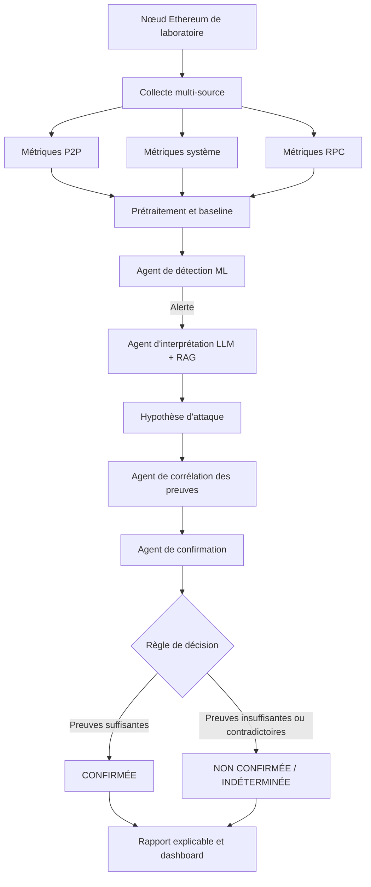

# EVA-Guard 🛡️

**Détection et confirmation agentiques des attaques ciblant les nœuds Ethereum**

EVA-Guard est un prototype de cybersécurité destiné à surveiller un nœud Ethereum, détecter des comportements anormaux, proposer une hypothèse d’attaque à l’aide d’un LLM enrichi par RAG, puis confirmer ou rejeter cette hypothèse à partir de preuves observables provenant de plusieurs sources.

> **Principe clé : détecter une anomalie ne signifie pas confirmer une attaque.** Le LLM interprète les événements et explique une hypothèse ; la décision finale s’appuie sur des indicateurs mesurables et une règle de décision explicite.

## 📌 Table des matières

- [Objectifs](#-objectifs)
- [Périmètre des attaques](#-périmètre-des-attaques)
- [Architecture](#-architecture)
- [Agents spécialisés](#-agents-spécialisés)
- [Sources de données et preuves](#-sources-de-données-et-preuves)
- [Technologies envisagées](#-technologies-envisagées)
- [Structure du dépôt](#-structure-du-dépôt)
- [Installation et démarrage](#-installation-et-démarrage)
- [Protocole expérimental](#-protocole-expérimental)
- [Évaluation](#-évaluation)
- [Sécurité et limites](#-sécurité-et-limites)
- [Livrables](#-livrables)
- [Feuille de route](#-feuille-de-route)
- [Références scientifiques](#-références-scientifiques)

## 🎯 Objectifs

EVA-Guard vise à :

- surveiller le comportement d’un nœud Ethereum à partir de données réseau P2P, système et RPC ;
- établir une baseline du comportement normal ;
- détecter automatiquement les anomalies à l’aide de méthodes de Machine Learning ;
- interpréter les alertes à l’aide d’un LLM et d’une base documentaire RAG spécialisée sur Ethereum ;
- coordonner des agents spécialisés pour corréler les observations ;
- prendre une décision explicable : `CONFIRMÉE`, `NON CONFIRMÉE` ou, si les données sont insuffisantes, `INDÉTERMINÉE` ;
- afficher les alertes, preuves, décisions et recommandations dans un dashboard.

## 🧪 Périmètre des attaques

### 1. Eclipse Attack — obligatoire

Une attaque Eclipse cherche à isoler un nœud de ses pairs honnêtes ou à contrôler une part importante de ses connexions P2P. EVA-Guard recherchera notamment :

- une baisse du nombre ou de la diversité des pairs ;
- des changements anormaux dans les connexions (*peer churn*) ;
- des indices d’isolement du nœud ;
- un retard inhabituel de synchronisation ou une progression anormale de la chaîne.

### 2. DoS par flooding P2P — obligatoire

Ce scénario étudie une surcharge provoquée par un volume excessif de messages ou de connexions P2P. Les indicateurs peuvent inclure :

- une hausse du trafic ou du nombre d’événements P2P ;
- une augmentation de l’utilisation CPU et mémoire ;
- une dégradation de la latence et de la disponibilité ;
- des erreurs, délais d’attente ou redémarrages anormaux.

### 3. RPC Flooding / Abuse — extension optionnelle

Ce scénario étudie une charge excessive sur l’interface RPC : taux de requêtes, méthodes appelées, latence, erreurs et consommation des ressources. Il sera ajouté uniquement lorsque les deux scénarios principaux seront correctement instrumentés et évalués.

**Important :** les scénarios d’attaque doivent être exécutés uniquement dans un laboratoire isolé, sur des nœuds et systèmes contrôlés par l’équipe.

## 🏗️ Architecture



### Principe de confirmation

1. Une anomalie est détectée dans les données observées.
2. Le LLM propose une hypothèse et fournit les éléments qui la motivent.
3. Le système collecte les indicateurs associés à cette hypothèse sur plusieurs sources.
4. L’agent de corrélation vérifie la concordance temporelle et la qualité des observations.
5. L’agent de confirmation applique une règle explicite et traçable.
6. Le dashboard présente la décision, les preuves retenues, les incertitudes et une recommandation.

Une alerte ML ou une réponse du LLM ne suffit donc jamais, à elle seule, à déclarer une attaque confirmée.

## 🤖 Agents spécialisés

| Agent | Responsabilité | Sortie attendue |
|---|---|---|
| Détection | Analyse les caractéristiques et détecte les écarts à la baseline | Score d’anomalie, horodatage, alerte |
| Interprétation | Utilise le LLM et le RAG pour proposer une hypothèse | Type d’attaque probable, explication, références documentaires |
| Corrélation | Regroupe les événements P2P, système et RPC pertinents | Paquet de preuves horodatées et indicateurs concordants/contradictoires |
| Confirmation | Applique les règles de décision définies | Statut, justification et niveau de confiance/calibration |
| Restitution | Produit un résumé lisible pour l’utilisateur | Rapport, chronologie et recommandation prudente |

## 🔎 Sources de données et preuves

| Source | Exemples de données | Utilité |
|---|---|---|
| P2P Ethereum | Nombre de pairs, connexions, déconnexions, événements réseau disponibles | Détecter l’isolement ou une activité P2P anormale |
| Système | CPU, mémoire, réseau, processus, disponibilité | Identifier une surcharge ou une dégradation du nœud |
| RPC | Nombre de requêtes, méthodes, latence, erreurs | Observer la charge et les abus de l’interface RPC |
| Synchronisation | Hauteur de bloc, progression, retard par rapport à la référence du laboratoire | Repérer un retard ou un comportement de synchronisation inhabituel |
| Journaux | Logs du client et événements horodatés | Fournir du contexte et relier les observations |

La disponibilité exacte des métriques dépend du client Ethereum choisi et de sa configuration. Les métriques indisponibles doivent être documentées plutôt que simulées comme si elles étaient réelles.

## 🧰 Technologies envisagées

Les choix ci-dessous constituent une proposition de départ et pourront évoluer selon l’environnement expérimental.

- **Blockchain :** client Ethereum compatible avec le laboratoire, par exemple Geth ou Nethermind ; réseau privé/local de test.
- **Collecte et traitement :** Python, scripts de collecte, journaux structurés et métriques système.
- **Machine Learning :** scikit-learn pour établir une baseline, avec comparaison de modèles simples.
- **LLM et orchestration :** LangChain et/ou LangGraph, avec un fournisseur de modèle configurable.
- **RAG :** base documentaire spécialisée Ethereum, embeddings et base vectorielle telle que ChromaDB.
- **API et dashboard :** FastAPI et une interface web légère, par exemple React ; alternatives possibles selon les besoins.
- **Évaluation :** pandas, scikit-learn et outils de visualisation.
- **Reproductibilité :** Git, fichiers de configuration, versions de dépendances et scénarios expérimentaux documentés.

Ces technologies sont proposées et ne signifient pas que toutes les intégrations sont déjà implémentées.

## 📁 Structure du dépôt

```text
eva-guard/
├── README.md
├── docs/
│   ├── architecture.md
│   ├── literature_review.md
│   └── experimental_protocol.md
├── config/
│   └── config.example.yaml
├── data/
│   ├── raw/                 # Données brutes (non versionnées si volumineuses/sensibles)
│   ├── processed/           # Données préparées
│   └── README.md            # Description et provenance du dataset
├── collectors/
│   ├── p2p_collector.py
│   ├── system_collector.py
│   └── rpc_collector.py
├── detection/
│   ├── features.py
│   ├── train.py
│   └── predict.py
├── rag/
│   ├── ingest_documents.py
│   └── retrieve_context.py
├── agents/
│   ├── detection_agent.py
│   ├── interpretation_agent.py
│   ├── correlation_agent.py
│   ├── confirmation_agent.py
│   └── reporting_agent.py
├── evaluation/
│   ├── metrics.py
│   └── compare_baselines.py
├── dashboard/
├── tests/
├── requirements.txt
└── .env.example
```

Cette arborescence est une organisation cible : adaptez-la à l’implémentation réelle et ne présentez pas les modules non développés comme fonctionnels.

## ⚙️ Installation et démarrage

### Prérequis

- Python 3.10 ou version compatible avec les dépendances retenues ;
- Git ;
- un client Ethereum et un réseau local de test configurés ;
- un accès aux métriques et journaux nécessaires ;
- une clé API LLM uniquement si le fournisseur choisi l’exige.

### 1. Cloner le dépôt

```bash
git clone <URL_DU_DEPOT>
cd eva-guard
```

### 2. Créer un environnement Python

```bash
python -m venv .venv
```

Sous Linux/macOS :

```bash
source .venv/bin/activate
```

Sous Windows PowerShell :

```powershell
.venv\Scripts\Activate.ps1
```

### 3. Installer les dépendances

Lorsque le fichier existe et est à jour :

```bash
pip install -r requirements.txt
```

### 4. Configurer le projet

Copier les fichiers d’exemple s’ils sont présents :

```bash
cp .env.example .env
cp config/config.example.yaml config/config.yaml
```

Renseigner les chemins de logs, les adresses des endpoints locaux, les paramètres de collecte et la configuration du LLM. Ne jamais committer de clés API ou de secrets dans Git.

### 5. Vérifier la collecte

Avant d’activer la détection, lancer les collecteurs disponibles et vérifier que :

- les données sont horodatées et structurées ;
- les métriques attendues sont réellement accessibles ;
- les valeurs manquantes sont identifiées ;
- la collecte n’affecte pas excessivement le nœud de test.

### 6. Exécuter le pipeline

Les commandes exactes dépendront de l’implémentation. À terme, le parcours attendu est :

```text
collecte → préparation des caractéristiques → détection ML
→ interprétation LLM/RAG → corrélation → confirmation → dashboard
```

Aucune commande de lancement n’est indiquée ici comme fonctionnelle tant que les points d’entrée correspondants n’ont pas été créés et testés.

## 🧪 Protocole expérimental

1. **Baseline normale :** collecter le comportement du nœud sans attaque, dans des conditions reproductibles.
2. **Scénarios contrôlés :** exécuter séparément les scénarios Eclipse et DoS P2P dans le laboratoire isolé.
3. **Étiquetage :** associer à chaque fenêtre temporelle un label expérimental documenté : normal, Eclipse, DoS P2P ou indéterminé.
4. **Prétraitement :** aligner les sources temporellement, gérer les valeurs manquantes et documenter les transformations.
5. **Séparation des données :** séparer les jeux d’entraînement et de test en évitant que des fenêtres quasi identiques se retrouvent dans les deux ensembles.
6. **Comparaison :** exécuter les trois configurations décrites dans la section Évaluation avec le même protocole de test.
7. **Analyse d’erreurs :** examiner les faux positifs, faux négatifs, délais et cas où les preuves sont contradictoires.
8. **Reproductibilité :** conserver les paramètres, versions, horodatages, labels et résultats nécessaires à la reproduction.

## 📊 Évaluation

Trois configurations doivent être comparées :

| Configuration | Description | Question étudiée |
|---|---|---|
| Baseline A | ML seul | Quelle est la performance de la détection d’anomalies seule ? |
| Baseline B | ML + LLM/RAG | Le contexte documentaire améliore-t-il l’interprétation des alertes ? |
| EVA-Guard | ML + LLM/RAG + agents + confirmation multi-source | La corrélation des preuves réduit-elle les fausses alertes ? |

### Métriques

- **Précision (Precision)** : part des alertes positives qui sont correctes.
- **Rappel (Recall)** : part des attaques présentes qui sont détectées.
- **F1-score** : moyenne harmonique de la précision et du rappel.
- **Taux de faux positifs (FPR)** : part des observations normales déclarées positives.
- **Temps de détection** : délai entre le début observable du scénario et la première alerte.
- **Temps de confirmation** : délai entre la première alerte et la décision finale.

Les résultats devront inclure les conditions de test, le nombre d’essais, les définitions des labels et, si possible, la variabilité entre essais. La décision `INDÉTERMINÉE` peut être utile lorsque les preuves sont insuffisantes ; elle doit être comptabilisée et expliquée dans l’évaluation.

### Étude ablative

Pour estimer la contribution de chaque composant, comparer EVA-Guard à des variantes où l’on retire successivement le RAG, la corrélation multi-source ou la règle de confirmation, tout en conservant le même protocole expérimental.

## 🛡️ Sécurité et limites

- Toutes les expériences d’attaque sont limitées à un environnement local ou explicitement autorisé.
- Le LLM peut produire des explications incorrectes : les sorties doivent être vérifiées et ne doivent pas être considérées comme des preuves.
- Le RAG doit citer les documents récupérés et distinguer les faits documentés des inférences.
- Les preuves doivent inclure leur source, leur horodatage et, si possible, leur qualité ou fiabilité.
- Une corrélation temporelle ne prouve pas automatiquement une causalité.
- Les seuils de confirmation doivent être définis avant l’évaluation, justifiés et testés sur des données séparées.
- Les résultats dépendent du client Ethereum, de la configuration réseau, de l’environnement et des données collectées.
- Les recommandations du prototype sont destinées à l’aide à l’analyse ; toute réponse automatique à fort impact doit rester désactivée par défaut.

## 📦 Livrables

- étude bibliographique des articles retenus ;
- schéma d’architecture et description de la plateforme expérimentale ;
- dataset documenté avec provenance, labels et protocole de collecte ;
- prototype EVA-Guard et dashboard ;
- comparaison des trois configurations de détection ;
- étude ablative et analyse des erreurs ;
- rapport final, code source et présentation.

## 🗓️ Feuille de route indicative

- [ ] Semaines 1–2 : étude bibliographique et prise en main d’Ethereum.
- [ ] Semaines 3–5 : installation, instrumentation et baseline normale.
- [ ] Semaines 6–8 : scénarios Eclipse et DoS P2P, collecte et documentation des données.
- [ ] Semaines 9–10 : caractéristiques et baseline ML.
- [ ] Semaines 11–12 : LLM, RAG et agents.
- [ ] Semaines 13–14 : corrélation, confirmation et intégration.
- [ ] Semaine 15 : évaluation comparative et étude ablative.
- [ ] Semaine 16 : rapport, démonstration et soutenance.

## 📚 Références scientifiques

Les références ci-dessous sont reprises du cahier des charges du projet. Vérifier les métadonnées, le texte intégral et les résultats exacts dans les publications avant de les citer dans le rapport.

1. **Houssel et al. — eX-NIDS (2026).** *Computers & Electrical Engineering*, 129, 110826. DOI : [10.1016/j.compeleceng.2025.110826](https://doi.org/10.1016/j.compeleceng.2025.110826).
2. **Rehman et al. — Eclipse Attack Detection (2026).** *Journal of Network and Computer Applications*, 246, 104416. DOI : [10.1016/j.jnca.2025.104416](https://doi.org/10.1016/j.jnca.2025.104416).
3. **Rosa-Bilbao et al. — Ethereum CEP Monitoring (2025).** *Computer Standards & Interfaces*, 91, 103882. DOI : [10.1016/j.csi.2024.103882](https://doi.org/10.1016/j.csi.2024.103882).
4. **BLAD-eLLM (2026)** : référence complémentaire mentionnée dans le cahier des charges ; compléter les informations bibliographiques après vérification de la source.

## 👥 Équipe et contribution

À compléter avec les noms des membres, leurs responsabilités et les liens utiles du projet.

## 📄 Licence

Licence à définir par l’équipe. Ajouter un fichier `LICENSE` avant toute diffusion publique du code.

---

**EVA-Guard — Observer, détecter, corroborer, confirmer.**
